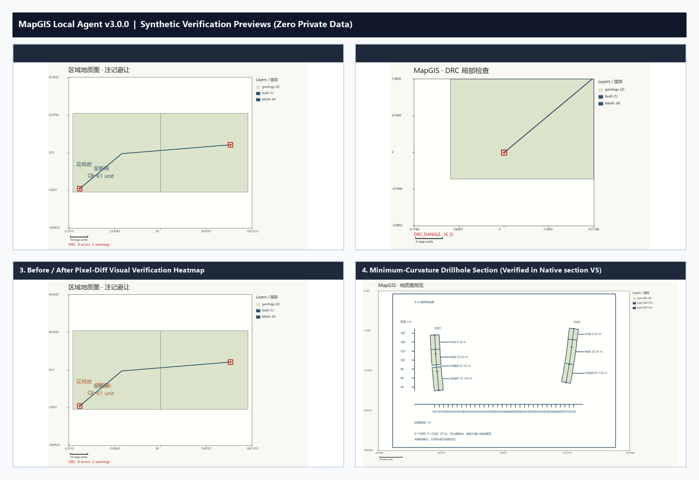
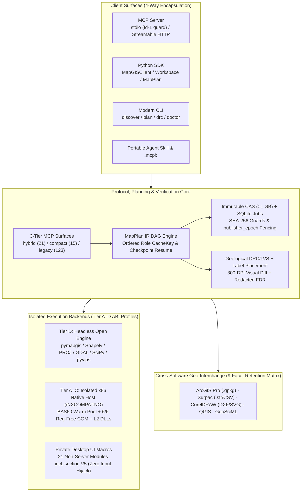

<div align="center">

# MapGIS Local Agent

### Production-Grade Geological Cartography & Local GIS Agent Platform (v3.0.0)

**Turn Claude, Cursor, Codex, or Antigravity into a verifiable, non-intrusive geological GIS workstation — cutting MCP context overhead by 94.4% (`259 KB → 14.5 KB`) with 30/30 MapGIS-Bench execution and zero desktop hijacking.**

<p>
  <a href="README.md"></a>
  <a href="README.zh-CN.md"></a>
  <a href="https://github.com/Nolanlaw/mapgis-local-agent/releases/tag/v3.0.0"></a>
  <a href="https://github.com/Nolanlaw/mapgis-local-agent/actions/workflows/ci.yml"></a>
  <a href="LICENSE"></a>
  <a href="https://modelcontextprotocol.io"></a>
  <a href="docs/V3-DELIVERY-REPORT.md"></a>
  <a href="packaging/sbom.spdx.json"></a>
</p>

<p>
  <a href="#-quick-start">Quick Start</a> ·
  <a href="#-why-mapgis-local-agent">Why This Project</a> ·
  <a href="#-try-these-prompts">Example Prompts</a> ·
  <a href="#-architecture">Architecture</a> ·
  <a href="#-benchmarks--verification">Benchmarks</a> ·
  <a href="docs/V3-DELIVERY-REPORT.md">v3.0 Report</a> ·
  <a href="https://github.com/Nolanlaw/mapgis-local-agent/releases/latest">Download .mcpb</a>
</p>

<br />



<sub>*All four panels above are deterministic renders generated from synthetic test fixtures during v3.0.0 verification — zero private or proprietary map data.*</sub>

</div>

---

## Why MapGIS Local Agent?

Legacy desktop GIS software was built for manual clicks, not autonomous AI agents. Naive MCP wrappers dump 100+ raw endpoints into the LLM context window, overwrite source files, hijack the user's cursor, and silently corrupt Chinese geodetic projections (`CGCS2000` / `EPSG:4528`).

**MapGIS Local Agent v3.0.0** treats geological mapmaking like an audited compiler and EDA toolchain:

| Capability | Typical GUI RPA / Mouse Bots | Naive 100+ Tool MCP Wrapper | **MapGIS Local Agent v3.0.0** |
| :--- | :---: | :---: | :---: |
| **Desktop & Cursor Safety** | Hijacks mouse & focus | Often attaches to user GUI | **Zero hijacking** — isolated x86 worker & Windows Private Desktop |
| **Context Window Cost** | High screenshot token burn | ~74,260 tokens (123 tools) | **~4,155 tokens (`hybrid` 21 tools, -94.4%)** / **~2,757 (`compact` 15, -96.3%)** |
| **Source File Safety** | Edits originals directly | Overwrites or partial writes | **SHA-256 guards + Immutable CAS (>1 GB tested) + `publisher_epoch` fencing** |
| **Reproducibility & Recovery** | Fragile, blind retries | No DAG cache or checkpoints | **Declarative `MapPlan IR`**, ordered role `CacheKey`, fault-resume & redacted **FDR** |
| **Geological QA (DRC / LVS)** | None | Basic geometry checks | **`GB/T 958-2015` + `DZ/T 0179-2025` LVS**, 300-DPI crop callouts & pixel-diff heatmap |
| **CGCS2000 & Zone Traps** | Manual guesswork | Silent WGS84 fallback / fails `EPSG:4528` | **Hash-bound CRS sidecar (`4490`/`4528`/`4549`)**, blocks 40,000,000 m easting mixups |
| **Native 6.7 Penetration** | Fragile UI clicks | File-only or partial | **6/6 registration-free COM libs**, L2 DLLs, **section V5** verified UI macros |
| **Cross-Software Bridge** | Manual export | None | **ArcGIS Pro / Surpac / CorelDRAW / QGIS / GeoSciML** with 9-facet retention matrix |

---

## Quick Start

Choose the packaging mode that fits your workflow — **headless file/QA/interchange tools work out of the box without a MapGIS installation**, and native MapGIS 6.7 execution opts in locally with your own licensed copy.

### Option 1: One-Click Desktop Extension (`.mcpb`)

Download [`mapgis-local-agent-3.0.0.mcpb`](https://github.com/Nolanlaw/mapgis-local-agent/releases/latest) from Releases (MCPB v0.4, verified on non-ASCII Windows paths, launches the 21-tool `hybrid` surface).

### Option 2: Install from Source (Windows, Python 3.12+)

The repository ships a prebuilt isolated x86 `MapgisNativeWorker.exe` (no Visual Studio needed for normal use):

```powershell
# Headless mode (file I/O, MapPlan IR, DRC/LVS, label placement, visual previews, cross-software interchange)
.\scripts\Setup.ps1 -Surface hybrid

# Full native mode (binds your existing licensed MapGIS 6.7 installation; no registry or system DEP changes)
.\scripts\Setup.ps1 -MapGISInstallation 'D:\MapGIS67' -EnableNativeLegacyHost -EnablePrivateUi -Surface hybrid
```

<details>
<summary><b>Connect to Claude Code, Cursor, Antigravity, or Codex CLI (Copy-Paste Configs)</b></summary>

Generate an exact client snippet anytime without modifying your global configs:

```powershell
.\.venv\Scripts\python.exe -s -B -X utf8 scripts/mapgis_cli.py setup-snippet --client auto --surface hybrid --root 'D:\MapGIS-Agent'
```

**Claude Code / Cursor / Antigravity (`mcpServers` JSON):**

```json
{
  "mcpServers": {
    "mapgis_local": {
      "command": "D:\\MapGIS-Agent\\.venv\\Scripts\\python.exe",
      "args": [
        "-s", "-B", "-X", "utf8",
        "D:\\MapGIS-Agent\\scripts\\launch_mcp.py",
        "--root", "D:\\MapGIS-Agent",
        "--surface", "hybrid"
      ]
    }
  }
}
```

**Codex CLI (`~/.codex/config.toml`):**

```toml
[mcp_servers.mapgis_local]
command = "D:/MapGIS-Agent/.venv/Scripts/python.exe"
args = ["-s", "-B", "-X", "utf8", "D:/MapGIS-Agent/scripts/launch_mcp.py", "--root", "D:/MapGIS-Agent", "--surface", "hybrid"]
```

**Standalone Agent Skill:** Drop [`packaging/skill/SKILL.md`](packaging/skill/SKILL.md) into any MCP-capable agent host.

</details>

### Option 3: Python SDK, Modern CLI & Streamable HTTP

```python
from mapgis_agent import MapGISClient, MapPlan

client = MapGISClient("D:/my-geology-project", surface="hybrid")
print(client.discover("topology polygonize", limit=5))
print(client.detect_providers())
```

```powershell
# Modern CLI (shares the exact same registry and safety ledger as MCP)
.\.venv\Scripts\python.exe -s -B -X utf8 scripts/mapgis_cli.py discover 'drillhole section' --root 'D:\MapGIS-Agent'
.\.venv\Scripts\python.exe -s -B -X utf8 scripts/mapgis_cli.py doctor --root 'D:\MapGIS-Agent'

# Optional Streamable HTTP transport (bound to 127.0.0.1:8765/mcp with Host & Origin validation)
.\.venv\Scripts\python.exe -s -B -X utf8 scripts/launch_mcp.py --root 'D:\MapGIS-Agent' --surface hybrid --transport streamable-http
```

---

## Try These Prompts

Once connected, talk to your AI agent in natural language:

1. **Topological Clean + Cartographic DRC Audit**
   > *"Inspect `faults.wl` and `strata.wp`, keep originals untouched, run full DRC against `GB/T 958-2015` and `DZ/T 0179-2025`, check for `EPSG:4528` vs `EPSG:4549` false-easting traps, render 300-DPI zoomed crops around every violation, and summarize fixes."*
2. **Editable Label Deconfliction + Visual Diff**
   > *"Run simulated-annealing label placement on `annotations.wt` while locking physical IDs `[1, 4, 9]`, preview the before/after pixel-diff heatmap, and prepare a reversible native patch without rasterizing the text."*
3. **End-to-End Drillhole Section & Multi-Track Column**
   > *"Build a reproducible `MapPlan` from `collar.csv`, `survey.csv`, `lithology.csv`, and `assay.csv` using minimum-curvature trajectories and 2x vertical exaggeration, generate editable native WT/WL/WP + MPJ outputs, verify reopening in `BAS60` and `section V5`, and export a redacted `.mapgis-fdr.zip`."*
4. **Multi-Sheet Edge Matching + Cross-Software Handoff**
   > *"Validate schema consistency between adjacent sheets `H50E001001` and `H50E001002`, report attribute conflicts without silently overwriting them, stitch matching boundaries, and export verified handoff packages for ArcGIS Pro (`.gpkg`), Surpac (`.str`), and CorelDRAW (`.dxf` + `.svg`) with the 9-facet retention matrix."*

---

## Architecture



---

## Benchmarks & Verification

All metrics below are directly measured on a licensed local MapGIS 6.7 host and archived in [`docs/V3-DELIVERY-REPORT.md`](docs/V3-DELIVERY-REPORT.md):

### 1. MCP Surface Compression & MapGIS-Bench (30 Paired Tasks)

| Surface | Tools | `tools/list` Payload | Est. Tokens | Token Reduction | MapGIS-Bench (30 Tasks) | Safety Checks |
| :--- | ---: | ---: | ---: | ---: | :---: | :---: |
| `legacy` | 123 | 259,909 B | ~74,260 | — | 10 / 30 | 2 / 4 |
| `compact` | 15 | 9,647 B | ~2,757 | **-96.29%** | **30 / 30 (100%)** | **4 / 4** |
| **`hybrid` (Recommended)** | **21** | **14,540 B** | **~4,155** | **-94.41%** | **30 / 30 (100%)** | **4 / 4** |

- **Bilingual Geological Discovery**: **48 / 48 (100%)** Top-5 hit rate, median **0.72 ms**, P95 **0.95 ms**.
- **Full Regression Suite**: **`1,498 passed, 0 failed`** (4 optional external host skips: `DesktopProbe.exe` ×2, `pwsh.exe` ×2).

### 2. Core Engineering Metrics

| Subsystem | Verified Measurement |
| :--- | :--- |
| **Immutable CAS Store** | Published & verified **1,073,741,825 B (>1 GB)** single object with a 28,672 B SQLite ledger and hardlink count = 1 |
| **3-Tier Native Worker Pool** | Median read latency **`881.9 ms → 11.6 ms`** (warm pool); paired edit step **`765.6 ms → 183.4 ms`**; `A→B→A` 12/12 isolation checks passed (`violations: []`) |
| **Registration-Free COM (L1)** | **6 / 6** libraries verified (`MapGisBasCom1`, `proj60`, `AttCom`, `MapGisMapCom`, `MapgisLayerCom`, `MapGisDspCom`), **19 / 21** real scenarios passed |
| **Hotspot Complexity Refactor** | Max cyclomatic complexity reduced: `vector.py` **`234 → 32` (-86.3%)**, `volume_native.py` **`134 → 38` (-71.6%)**, `native_ui_core.py` **`81 → 46` (-43.2%)** |
| **License & Supply Chain** | SPDX 2.3 SBOM covers 65 installed distributions / 84 packages with **0 `UNKNOWN` licenses**; 0 direct GPL `winhlp` imports outside standalone indexer |

---

## Tool Surface Reference (`hybrid` — 21 Tools)

<details>
<summary><b>Click to expand all 21 tools, 4 MCP Resources/Templates, and 5 Geological Prompts</b></summary>

- **15 Compact Deep-Module Tools**: `mapgis_discover`, `mapgis_environment`, `mapgis_inspect`, `mapgis_execute` (routes all 177 catalog operations with optional `async_job=True`), `mapgis_run_plan` (`plan`/`diff`/`apply`/`resume`/`import_mpj`), `mapgis_sdk_flow`, `mapgis_private_ui`, `mapgis_workspace`, `mapgis_job_manage`, `mapgis_tx_commit`, `mapgis_tx_manage`, `mapgis_tx_recovery`, `mapgis_export_plot`, `mapgis_audit_check` (full DRC/LVS/accounting), `mapgis_compare`.
- **6 High-Frequency Direct Tools (added in `hybrid`)**: `mapgis_read_features`, `mapgis_make_work_copy`, `mapgis_prepare_patch`, `mapgis_prepare_file_operation`, `mapgis_prepare_native_project`, `mapgis_prepare_project_plot`.
- **MCP Resources & Templates**: `mapgis://operations/catalog`, `mapgis://operations/{operation_id}`, `mapgis://help/{module}/{topic_id}`, `mapgis://standards/cartography`.
- **MCP Prompts**: `geological-map-production`, `topology-clean-polygonize`, `geochemistry-anomaly-workflow`, `drillhole-section-column`, `scan-to-vector-geology`.

</details>

---

## Honest Operational Boundaries

We explicitly document observed host boundaries rather than hiding them:

- **Native 6.7 COM / L2**: `MapGisBasCom1.Field` rejects NULL writes (`HRESULT 0x80020009`); `MapGisMapCom.legend` times out; direct `NetSolver`/`n60_oper` calls trigger modal `#32770` dialogs and are excluded from headless routing; `MapSuvL67.exe` WT header normalization is byte-verified on injected anomalies (live field anomaly sample pending).
- **Module & Generation Scope**: `DTM6x.exe` is an archive stub without payload (3D scenes use verified native scene SDK & `DTM3DFly`); C/S server-database modules are out of scope; MapGIS 10.x is modeled via the [`MapGIS10ProviderStub`](src/mapgis_agent/providers/mapgis10_stub.py) contract and reports `NOT_INSTALLED_ON_HOST` until a 10.x runtime is present.
- **Native Licensing**: This repository contains **zero MapGIS binaries, license tools, symbol libraries, or private map data**.

---

## Documentation & License

- [v3.0.0 Delivery Report](docs/V3-DELIVERY-REPORT.md) · [Capabilities](docs/CAPABILITIES.md) · [Local 6.7 Routes](docs/LOCAL67-ROUTES.md) · [Native Interface](docs/NATIVE.md) · [SDK Calls](docs/SDK-CALLS.md) · [Security Policy](SECURITY.md)
- **License**: Original project code is licensed under **[Apache-2.0](LICENSE)** (provided as-is). Third-party components — including subprocess-isolated GPL-2.0 `winhlp`, standalone CLI AGPL-3.0 `Ghostscript`, and LGPL-3.0 `libvips`/`wellpathpy` — retain their original licenses and compliance sources; see [NOTICE.md](NOTICE.md), [docs/THIRD-PARTY.md](docs/THIRD-PARTY.md), and [packaging/sbom.spdx.json](packaging/sbom.spdx.json).
