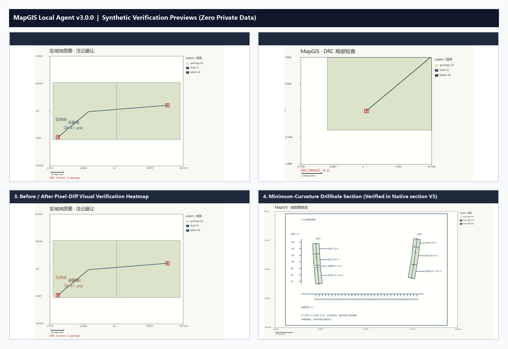
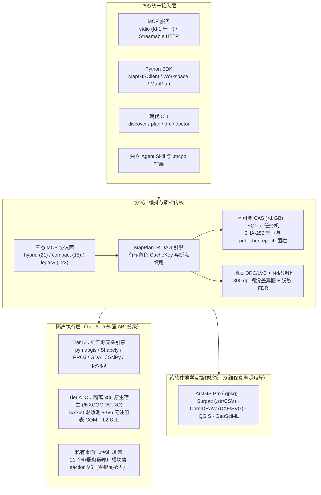

<div align="center">

# MapGIS Local Agent

### 面向地质制图与空间分析的工程级本机 Agent 平台（v3.0.0）

**让 Claude、Cursor、Codex 或 Antigravity 安全、可复现、不抢占桌面地完成专业 MapGIS 工作——MCP 上下文开销直降 94.4%（`259 KB → 14.5 KB`），MapGIS-Bench 30/30 全通过，零原件覆写。**

<p>
  <a href="README.md"></a>
  <a href="README.zh-CN.md"></a>
  <a href="https://github.com/Nolanlaw/mapgis-local-agent/releases/tag/v3.0.0"></a>
  <a href="https://github.com/Nolanlaw/mapgis-local-agent/actions/workflows/ci.yml"></a>
  <a href="LICENSE"></a>
  <a href="https://modelcontextprotocol.io"></a>
  <a href="docs/V3-DELIVERY-REPORT.md"></a>
  <a href="packaging/sbom.spdx.json"></a>
</p>

<p>
  <a href="#-快速开始">快速开始</a> ·
  <a href="#-为什么选择本项目">核心对比</a> ·
  <a href="#-直接这样对-ai-说话">实战示例</a> ·
  <a href="#-系统架构">系统架构</a> ·
  <a href="#-实测基准与验证">实测数据</a> ·
  <a href="docs/V3-DELIVERY-REPORT.md">v3.0 交付报告</a> ·
  <a href="https://github.com/Nolanlaw/mapgis-local-agent/releases/latest">下载 .mcpb</a>
</p>

<br />



<sub>*以上四联图全部由 v3.0.0 验证流程使用合成测试数据确定性生成，不含任何私密或专有地质数据。*</sub>

</div>

---

## 为什么选择本项目

传统桌面 GIS 为人工点击而设计。常见的“薄包装 MCP”直接把上百个接口塞进上下文，不仅撑爆 Token、容易选错工具，还会面临覆写原件、抢占桌面键鼠、以及静默破坏中国坐标系（`CGCS2000` / `EPSG:4528` 4,000 万米假东距）等致命工程隐患。

**MapGIS Local Agent v3.0.0** 引入了编译器、EDA 芯片设计规则检查（DRC/LVS）与数据库事务围栏思想：

| 维度 | 传统 GUI 键鼠自动化（RPA） | 普通 100+ 工具套壳 MCP | **MapGIS Local Agent v3.0.0** |
| :--- | :---: | :---: | :---: |
| **桌面键鼠安全** | 强占鼠标与焦点 | 常需挂载用户前台窗口 | **零抢占** — 隔离 x86 子进程 + Windows 私有桌面 |
| **上下文 Token 成本** | 高频截图消耗巨大 | ~74,260 Token（123 工具） | **~4,155 Token（`hybrid` 21 工具，-94.4%）** / **~2,757（`compact` 15，-96.3%）** |
| **原件与发布安全** | 直接修改原件 | 易覆写或半截写入 | **SHA-256 守卫 + 不可变 CAS（实测 >1 GB）+ `publisher_epoch` 围栏** |
| **可复现与断点续跑** | 脆弱、盲目重跑 | 无 DAG 缓存与检查点 | **声明式 `MapPlan IR`**、有序角色 `CacheKey`、故障恢复与脱敏 **FDR 黑匣子** |
| **地质质检闭环** | 无 | 仅基础几何有效性 | **`GB/T 958-2015` + `DZ/T 0179-2025` LVS**、300 dpi 违规放大与差异热图 |
| **CGCS2000 与带号陷阱** | 人工肉眼核对 | 静默退化 WGS84 / 拒收 `4528` | **哈希绑定 CRS 伴生契约（`4490`/`4528`/`4549`）**，严拦 4,000 万米假东距混用 |
| **原厂 6.7 深度穿透** | 脆弱弹窗点击 | 仅纯文件读写 | **6/6 无注册表 COM 库**、L2 DLL、**自由工作室 `section V5`** 已验证 UI 宏 |
| **跨软件协同桥接** | 手工倒腾格式 | 无 | **ArcGIS Pro / Surpac / CorelDRAW / QGIS / GeoSciML**（含 9 维保真声明） |

---

## 快速开始

支持**纯无头开源模式（无需安装 MapGIS 即可使用文件编辑、MapPlan、DRC 审图、注记避让、视觉预览与跨软件互操作）**，也可按需本地授权绑定你自己的正版 MapGIS 6.7 安装目录。

### 方式一：一键桌面扩展（`.mcpb`）

前往 [GitHub Releases](https://github.com/Nolanlaw/mapgis-local-agent/releases/latest) 下载 `mapgis-local-agent-3.0.0.mcpb`（MCPB v0.4，已在中文路径目录实测解包启动并枚举 21 工具）。

### 方式二：从源码一键安装（Windows，Python 3.12+）

仓库已附预编译隔离 x86 `MapgisNativeWorker.exe`，常规使用无需安装 Visual Studio：

```powershell
# 纯无头模式（无需本机 MapGIS 安装）
.\scripts\Setup.ps1 -Surface hybrid

# 完整原生模式（绑定本机已有正版 MapGIS 6.7；不修改系统注册表或全局 DEP 设置）
.\scripts\Setup.ps1 -MapGISInstallation 'D:\MapGIS67' -EnableNativeLegacyHost -EnablePrivateUi -Surface hybrid
```

<details>
<summary><b>接入 Claude Code / Cursor / Antigravity / Codex CLI（直接复制配置）</b></summary>

也可随时用 CLI 生成精准配置片段（仅输出到终端，绝不改动全局配置）：

```powershell
.\.venv\Scripts\python.exe -s -B -X utf8 scripts/mapgis_cli.py setup-snippet --client auto --surface hybrid --root 'D:\MapGIS-Agent'
```

**Claude Code / Cursor / Antigravity（合并进 `mcpServers`）：**

```json
{
  "mcpServers": {
    "mapgis_local": {
      "command": "D:\\MapGIS-Agent\\.venv\\Scripts\\python.exe",
      "args": [
        "-s", "-B", "-X", "utf8",
        "D:\\MapGIS-Agent\\scripts\\launch_mcp.py",
        "--root", "D:\\MapGIS-Agent",
        "--surface", "hybrid"
      ]
    }
  }
}
```

**Codex CLI（写入 `~/.codex/config.toml`）：**

```toml
[mcp_servers.mapgis_local]
command = "D:/MapGIS-Agent/.venv/Scripts/python.exe"
args = ["-s", "-B", "-X", "utf8", "D:/MapGIS-Agent/scripts/launch_mcp.py", "--root", "D:/MapGIS-Agent", "--surface", "hybrid"]
```

**独立 Agent Skill**：直接将 [`packaging/skill/SKILL.md`](packaging/skill/SKILL.md) 装入任意支持 Skill 的 Agent 宿主。

</details>

### 方式三：Python SDK、现代 CLI 与 Streamable HTTP

```python
from mapgis_agent import MapGISClient, MapPlan

client = MapGISClient("D:/my-geology-project", surface="hybrid")
print(client.discover("拓扑造区", limit=5))
print(client.detect_providers())
```

```powershell
# 现代 CLI（与 MCP 共享同一套工具注册表与安全账本）
.\.venv\Scripts\python.exe -s -B -X utf8 scripts/mapgis_cli.py discover '钻孔剖面' --root 'D:\MapGIS-Agent'
.\.venv\Scripts\python.exe -s -B -X utf8 scripts/mapgis_cli.py doctor --root 'D:\MapGIS-Agent'

# 可选 Streamable HTTP 传输（默认仅监听 127.0.0.1:8765/mcp，内置 Host/Origin 校验）
.\.venv\Scripts\python.exe -s -B -X utf8 scripts/launch_mcp.py --root 'D:\MapGIS-Agent' --surface hybrid --transport streamable-http
```

---

## 直接这样对 AI 说话

接通后，你可以直接用自然语言指挥 Agent 完成完整专业工序：

1. **拓扑造区 + 地质图 DRC/LVS 全链路审图**
   > “检查 `faults.wl` 和 `strata.wp`，绝对保留原件，按 `GB/T 958-2015` 和 `DZ/T 0179-2025` 做全套 DRC/LVS 审查，排查是否存在 `EPSG:4528` 与 `EPSG:4549` 假东距混用，对每个违规点输出 300 dpi 局部放大图并给出修复建议。”
2. **可编辑原生注记自动避让 + 视觉差分核验**
   > “对 `annotations.wt` 运行模拟退火注记避让，锁定人工已确认的物理 ID `[1, 4, 9]` 不动，输出修改前后的像素差异热图，并准备可编辑的原生 WT 偏移补丁（不要栅格化文字）。”
3. **钻孔勘探线剖面 + 多道综合柱状图端到端成图**
   > “根据 `collar.csv`、`survey.csv`、`lithology.csv`、`assay.csv` 构建可复现 `MapPlan`，采用最小曲率法轨迹和 2 倍垂向夸大生成可编辑原生 WT/WL/WP 与 MPJ，通过 `BAS60` 与私有桌面 `section V5` 打开验证，并导出脱敏 `.mapgis-fdr.zip` 留档。”
4. **多图幅接边缝合 + 跨软件专业交接**
   > “校验相邻标准图幅 `H50E001001` 与 `H50E001002` 的字段字典一致性，报告属性冲突绝不静默覆盖，对属性一致的边界执行中点缝合，并导出带 9 维保真/损耗声明矩阵的 ArcGIS Pro（`.gpkg`）、Surpac（`.str`）和 CorelDRAW（`.dxf` + `.svg`）交接包。”

---

## 系统架构



---

## 实测基准与验证

以下所有数据均源自本机实测回执，完整索引见 [`docs/V3-DELIVERY-REPORT.md`](docs/V3-DELIVERY-REPORT.md)：

### 1. MCP 三态表面与 MapGIS-Bench（30 题真实配对评测）

| 表面 | 工具数 | `tools/list` 字节 | 估算 Token | Token 压缩率 | MapGIS-Bench（30 题） | 安全拦截 |
| :--- | ---: | ---: | ---: | ---: | :---: | :---: |
| `legacy` | 123 | 259,909 B | ~74,260 | — | 10 / 30 | 2 / 4 |
| `compact` | 15 | 9,647 B | ~2,757 | **-96.29%** | **30 / 30 (100%)** | **4 / 4** |
| **`hybrid`（推荐）** | **21** | **14,540 B** | **~4,155** | **-94.41%** | **30 / 30 (100%)** | **4 / 4** |

- **双语地质检索**：**48 / 48（100%）** Top-5 命中，中位 **0.72 ms**，P95 **0.95 ms**。
- **全仓回归测试**：**`1,498 passed, 0 failed`**（仅 4 项因本机缺可选外部工具跳过：`DesktopProbe.exe`×2、`pwsh.exe`×2）。

### 2. 核心工程实测指标

| 子系统 | 实测结果 |
| :--- | :--- |
| **不可变 CAS 大对象库** | 写入并校验读回 **1,073,741,825 B（>1 GB）** 单对象，SQLite 账本仅 28,672 B、硬链接数 = 1 |
| **三级原生进程池** | 只读中位延迟 **`881.9 ms → 11.6 ms`**；配对编辑步 **`765.6 ms → 183.4 ms`**；`A→B→A` 12/12 隔离校验零串味 |
| **无注册表 COM（L1）** | **6 / 6** 原厂 COM 库全通（`MapGisBasCom1`/`proj60`/`AttCom`/`MapGisMapCom`/`MapgisLayerCom`/`MapGisDspCom`），**19 / 21** 实测场景通过 |
| **热点圈复杂度解耦** | 最大圈复杂度显著下降：`vector.py` **`234 → 32`（-86.3%）**、`volume_native.py` **`134 → 38`（-71.6%）**、`native_ui_core.py` **`81 → 46`（-43.2%）** |
| **开源合规与供应链** | SPDX 2.3 SBOM 覆盖 65 个安装分发 / 84 个包，**0 个 `UNKNOWN` 许可**；独立索引进程外 GPL `winhlp` 直接导入数 `0` |

---

## 工具面速查（`hybrid` 21 工具）

<details>
<summary><b>展开查看全部 21 个工具、4 类 MCP Resources 与 5 个地质 Prompts</b></summary>

- **15 个紧凑深模块工具**：`mapgis_discover`、`mapgis_environment`、`mapgis_inspect`、`mapgis_execute`（统一派发全部 177 项注册操作，支持 `async_job=True`）、`mapgis_run_plan`（`plan`/`diff`/`apply`/`resume`/`import_mpj`）、`mapgis_sdk_flow`、`mapgis_private_ui`、`mapgis_workspace`、`mapgis_job_manage`、`mapgis_tx_commit`、`mapgis_tx_manage`、`mapgis_tx_recovery`、`mapgis_export_plot`、`mapgis_audit_check`（全套 DRC/LVS/面积守恒）、`mapgis_compare`。
- **6 个高频强类型直达工具（`hybrid` 新增）**：`mapgis_read_features`、`mapgis_make_work_copy`、`mapgis_prepare_patch`、`mapgis_prepare_file_operation`、`mapgis_prepare_native_project`、`mapgis_prepare_project_plot`。
- **MCP Resources / Templates**：`mapgis://operations/catalog`、`mapgis://operations/{operation_id}`、`mapgis://help/{module}/{topic_id}`、`mapgis://standards/cartography`。
- **地质专业 Prompts**：`geological-map-production`、`topology-clean-polygonize`、`geochemistry-anomaly-workflow`、`drillhole-section-column`、`scan-to-vector-geology`。

</details>

---

## 诚实运行边界

- **原厂 6.7 COM / L2 边界**：`MapGisBasCom1.Field` 写 NULL 返回 `HRESULT 0x80020009`；`MapGisMapCom.legend` 调用超时；`NetSolver`/`n60_oper` 底层组合调用会触发 `#32770` 弹窗，不纳入无头直调；`MapSuvL67.exe` WT 异常头规范化器已在注入样本上逐字节验真，实机故障原样待补。
- **模块与代际边界**：`DTM6x.exe` 为缺载荷解包壳（三维走已验证原厂场景 SDK 与 `DTM3DFly`）；C/S 服务器数据库模块刻意排除；MapGIS 10.x 已通过 [`MapGIS10ProviderStub`](src/mapgis_agent/providers/mapgis10_stub.py) 预留 Provider 扩展契约，无 10.x 运行时环境时按 `NOT_INSTALLED_ON_HOST` 报告。
- **零原厂与私密资产**：本仓库不包含任何 MapGIS 安装程序、授权许可、专有符号库或私人地质图件。

---

## 文档与开源协议

- [v3.0.0 交付报告](docs/V3-DELIVERY-REPORT.md) · [能力说明](docs/CAPABILITIES.md) · [本机调用范围](docs/LOCAL67-ROUTES.md) · [原生接口](docs/NATIVE.md) · [SDK 调用](docs/SDK-CALLS.md) · [安全策略](SECURITY.md)
- **许可协议**：本项目原创代码采用标准 **[Apache-2.0](LICENSE)** 许可协议（按现状提供）。第三方组件（含独立子进程调用的 GPL-2.0 `winhlp`、独立 CLI 调用的 AGPL-3.0 `Ghostscript`、LGPL-3.0 `libvips`/`wellpathpy` 等）保留各自原始许可与源码合规要求，详见 [NOTICE.md](NOTICE.md)、[docs/THIRD-PARTY.md](docs/THIRD-PARTY.md) 与 [packaging/sbom.spdx.json](packaging/sbom.spdx.json)。
